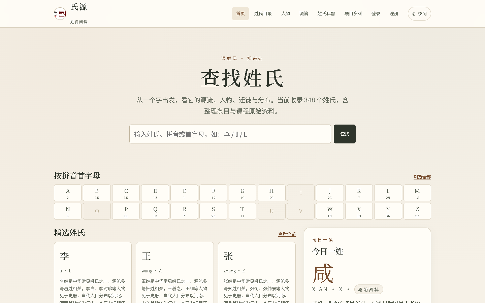
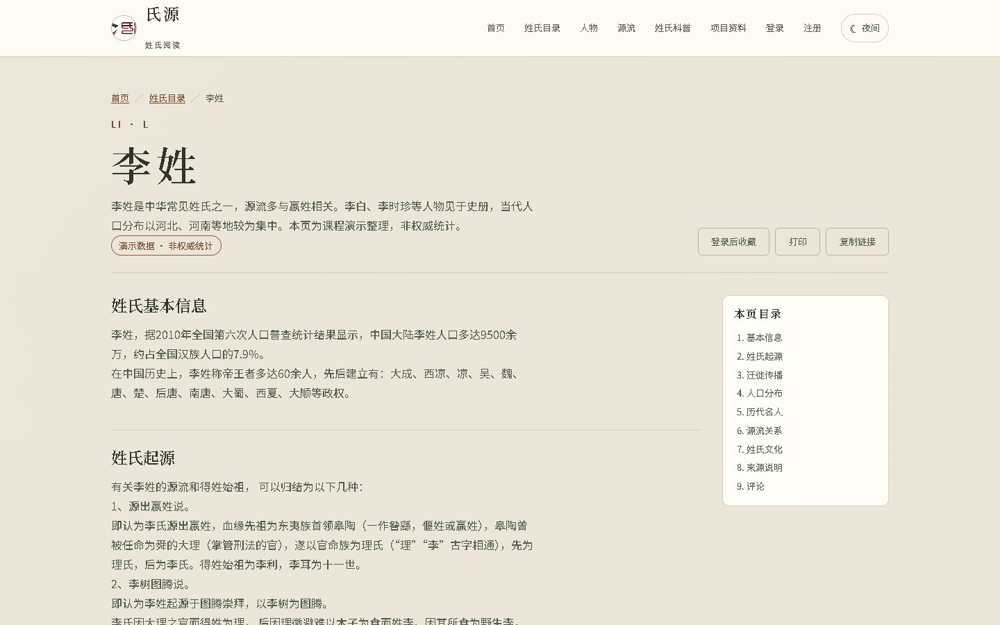
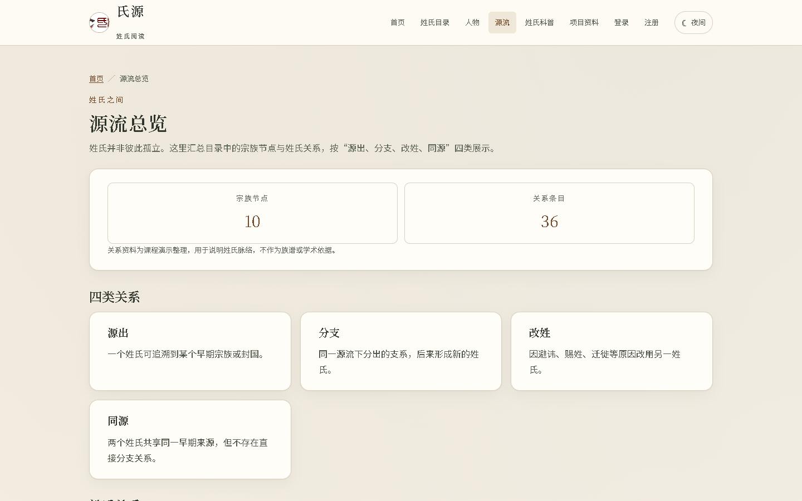
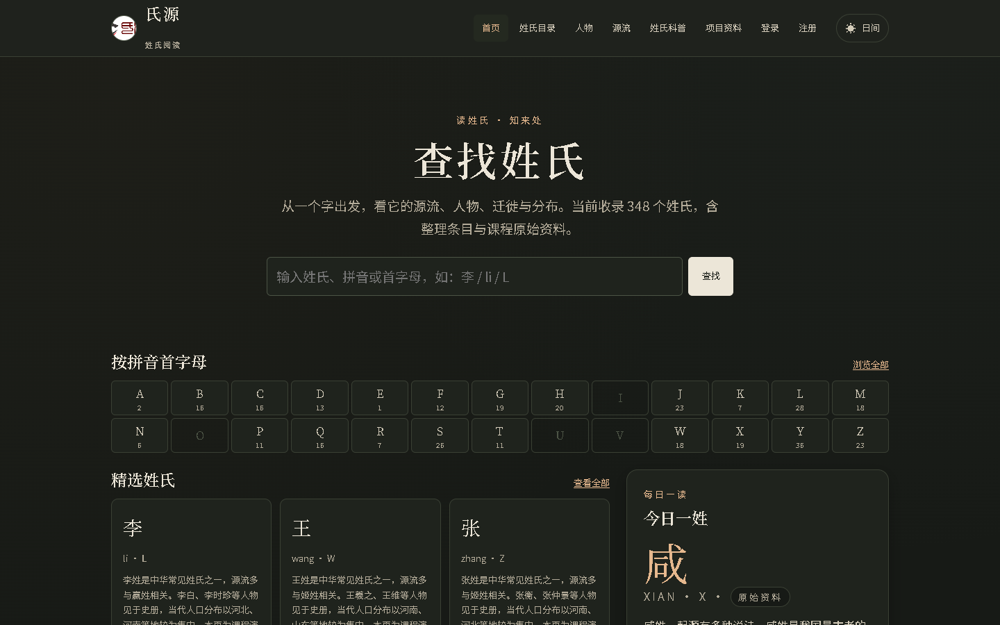
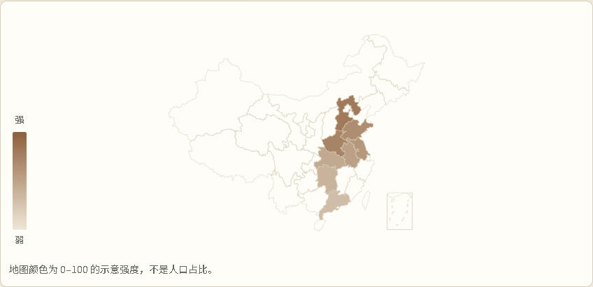
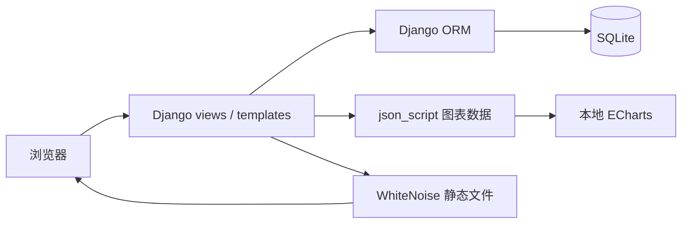

# 氏源 · 姓氏阅读与可视化

[](https://github.com/ningbojian/shiyuan/actions/workflows/ci.yml)

**在线演示：** <https://ningbojian.pythonanywhere.com/>（PythonAnywhere 免费版，部署步骤见 [`docs/DEPLOY.md`](docs/DEPLOY.md)）

> 查一个姓氏，读它的源流、人物、迁徙与分布。  
> 课程项目的重构版：Django 5.2 + SQLite + 本地 ECharts，348 个姓氏的阅读型目录站。



## 30 秒了解

- **做什么**：把姓氏资料组织成可检索、可浏览的目录，并用地图、词云、关系图和迁徙时间轴辅助阅读。
- **技术栈**：Django 5.2、SQLite、Django 模板 + 原生 JS/CSS、ECharts 5（仓库内静态文件）、WhiteNoise、pypinyin。
- **工程重点**：数据可复现加载、写入操作安全、查询预算、自动化测试、离线静态资源、无障碍与 SEO。
- **不是**：不是论坛，也不是权威姓氏数据库；分布强度是 0–100 的示意值，不是人口统计。

## 功能

**浏览与检索**

- 首页搜索、拼音首字母索引、精选姓氏、每日一姓；
- 姓氏目录支持关键词、首字母、省份与排序筛选，分页保留查询参数；
- 搜索匹配姓氏、拼音、首字母、别名与摘要。

**姓氏详情**

- 目录（TOC）、基本信息、源流、迁徙、分布、人物、文化、来源说明与评论；
- 分布地图、迁徙时间轴、姓氏关系图、关键词词云，全部使用本地 ECharts 且懒加载；
- 每张图都提供 `<details>` 数据表作为文本替代与打印内容。

**人物与源流**

- `/surname/figures/` 按朝代、姓氏筛选人物，详情页展示生卒、简介与同朝代人物；
- `/surname/origins/` 汇总宗族节点与“源出/分支/改姓/同源”关系，并用关系图呈现。

**账号与数据安全**

- 注册、登录、退出、资料编辑、密码修改；使用 Django 内置 `auth.User` + `Profile`；
- 收藏、浏览历史（最多保留 50 条）、本人评论管理与个人中心；
- 评论/收藏/历史/删除均为 POST + CSRF，服务端校验对象归属；
- 登录失败 5 次/5 分钟、评论 10 条/10 分钟限流，并写入审计日志。

**可复用数据与发布**

- 只读 JSON API v1：姓氏目录、详情、搜索、人物与元数据，见 [`docs/API.md`](docs/API.md)；
- `sitemap.xml`、`robots.txt`、canonical、Open Graph/Twitter 卡片；
- 姓氏详情输出 `WebPage` JSON-LD，人物详情输出 `Person` JSON-LD。

## 效果截图

| 首页 | 姓氏详情 |
|---|---|
|  |  |

| 人物索引 | 源流总览 |
|---|---|
|  |  |

| 移动端 | 夜间模式 |
|---|---|
|  |  |

| 分布地图（示意强度） |
|---|
|  |

更多验收记录见 [`docs/QA.md`](docs/QA.md)。

## 技术架构



- 服务端渲染，无 SPA、无 Node 构建链；
- 图表数据通过 `json_script` 输出，前端不拼接 HTML；
- 原 pyecharts、pickle、CDN 和 `|safe` 渲染路径已移除；
- 数据唯一来源是 `data/catalog.json`，由管理命令校验并加载。

## 数据

`data/catalog.json` 当前包含：

| 内容 | 数量 |
|---|---|
| 姓氏 | 348（33 个整理条目 + 315 个课程原始资料条目） |
| 历史人物 | 6,251 |
| 迁徙事件 | 66 |
| 源流关系 | 36 |
| 宗族节点 | 10 |
| 省份 / 时期 | 34 / 22 |

李、王、张、丁四姓的原始课程文本完整保留在 `data/surnames/`；另有 315 个姓氏来自上海财经大学《数据库原理》2021 Fall 课程归档。源目录不随仓库提交，导入条目标记 `is_imported=True`，内容未校订。31 个重叠姓氏保留整理正文，只合并原始人物；41 条同姓同名原始人物按最长简介合并，8 条空信息跳过。源归档中的“上官”文件夹实际是又姓资料，因此目录中有“又”而无“上官”。

课程原始资料的分布/迁徙多为文字，未自动抽取为结构化数据；页面会显示原文，并明确标注“暂无结构化数据”。分布强度只存在于 33 个整理条目中，是可视化示意值，不是人口占比；整理记录带 `is_demo=True` 与来源说明。详见 [`docs/DATA.md`](docs/DATA.md)。

**为什么 SQLite 够用：** 当前 348 姓氏、6,251 人物、约 6.6 MB JSON，数据库约 10–25 MB；部署为单 worker、读多写少，评论/收藏/历史都是低频小事务。只有多 worker/多实例、持续高并发写、全文检索或平台磁盘非持久时，才需要迁移 PostgreSQL。

## 快速开始

要求：Python 3.11+（推荐 3.13）。

```bash
python -m venv .venv
source .venv/Scripts/activate        # Git Bash on Windows
pip install -r requirements.txt

export DJANGO_DEBUG=1
export DJANGO_SECRET_KEY=dev-only-change-me
export DJANGO_ALLOWED_HOSTS=127.0.0.1,localhost

python manage.py migrate
python manage.py load_catalog
python manage.py seed_demo
python manage.py runserver 127.0.0.1:8000
```

打开 <http://127.0.0.1:8000/>。

- 演示账号：`demo` / `demo123456`，仅由 `seed_demo` 在 `DEBUG=1` 时创建；生产环境需显式 `--force` 且会打印警告。公网演示站首次部署后已轮换该密码，这里的密码只用于本地开发环境。
- PowerShell 请使用 `$env:DJANGO_DEBUG="1"` 等写法。
- 项目不自动加载 `.env`；[`.env.example`](.env.example) 只是变量清单。
- 开发环境缺少 `DJANGO_SECRET_KEY` 时会生成并复用 `.dev-secret-key`（已 gitignore）；生产环境缺少则直接报错。

## 测试与质量

```bash
DJANGO_DEBUG=1 python manage.py test -v 2
ruff check .
DJANGO_DEBUG=1 python manage.py check
```

- 219 个 Django 测试，覆盖模型约束、目录加载/校验、课程归档解析、搜索分页、认证与 CSRF/IDOR、评论 XSS、收藏/历史、API、SEO 与部署配置；
- 查询预算：首页 6 条、目录 ≤ 5 条、详情 ≤ 16 条、人物列表 ≤ 5 条；
- Lighthouse 无障碍 1.00（5 个页面），375/768/1440 px 无横向溢出；
- GitHub Actions 执行 `check`、`test`、`ruff` 与生产模式 `collectstatic`。

复现方式与已知限制见 [`docs/QA.md`](docs/QA.md)。

## 目录结构

```text
shiyuan/
├─ project/                  # settings / urls / test runner
├─ Surname/
│  ├─ models.py              # 姓氏、省份、朝代、分布、人物、宗族、关系、迁徙
│  ├─ views.py               # 首页、目录、搜索、详情、人物、源流
│  ├─ api.py / api_urls.py   # /api/v1 只读 JSON API
│  ├─ sitemaps.py            # sitemap.xml
│  ├─ services/catalog.py    # catalog 校验、slug、加载
│  ├─ management/commands/   # load_catalog / validate_catalog / seed_demo
│  ├─ templatetags/          # JSON-LD 安全序列化
│  └─ tests/
├─ user/                     # 账号、Profile、评论、收藏、历史、限流
├─ templates/                # 全站壳、robots.txt、404/500
├─ static/                   # 纸墨样式、站点 JS、图表 JS、本地 ECharts
├─ data/
│  ├─ catalog.json           # 348 个姓氏的唯一可复现数据源（含 315 个原始条目）
│  └─ surnames/              # 李、王、张、丁原始文本样本
├─ docs/                     # API / DATA / QA / 项目报告 / 截图
├─ .github/workflows/ci.yml
└─ requirements.txt
```

## 数据命令

```bash
python manage.py validate_catalog           # 校验 catalog 与数据契约
python manage.py load_catalog --dry-run     # 只打印统计，不写库
python manage.py load_catalog               # 加载/同步目录
python manage.py seed_demo                  # 省份、朝代、演示账号、评论、收藏、历史
```

修改 `data/surnames/` 或生成脚本后重建 `data/catalog.json`：

```bash
# 有课程归档时：生成 33 个整理条目 + 315 个原始条目
python scripts/generate_catalog.py --source-dir "<课程归档目录>" --output data/catalog.json

# 没有归档时：只生成 33 个整理条目；不要用它覆盖已导入的完整 catalog
python scripts/generate_catalog.py
```

源归档不随仓库提交；`data/catalog.json` 是站点唯一可复现数据源。生成后再执行上面的校验/加载命令。

## API、SEO 与部署

- API 文档：[`docs/API.md`](docs/API.md)
- 数据说明：[`docs/DATA.md`](docs/DATA.md)
- 无障碍与响应式：[`docs/QA.md`](docs/QA.md)
- 项目状态与后续计划：[`PROJECT_STATE.md`](PROJECT_STATE.md)
- 课程背景与技术报告：[`docs/PROJECT_REPORT.md`](docs/PROJECT_REPORT.md)
- 免费公网部署：[`docs/DEPLOY.md`](docs/DEPLOY.md)（PythonAnywhere）

**GitHub Pages 不能运行 Django**：它只托管静态文件，登录、评论、收藏、历史和 API 都需要 Python 进程与数据库。完整功能的免费部署见 [`docs/DEPLOY.md`](docs/DEPLOY.md)。

VPS + gunicorn 示例（PythonAnywhere 见 [`docs/DEPLOY.md`](docs/DEPLOY.md)）：

```bash
pip install -r requirements-prod.txt

export DJANGO_DEBUG=0
export DJANGO_SECRET_KEY="<50+ 字符随机值>"
export DJANGO_ALLOWED_HOSTS="example.com"
export DJANGO_CSRF_TRUSTED_ORIGINS="https://example.com"
export DJANGO_SECURE_SSL=1
export DJANGO_TRUST_X_FORWARDED_PROTO=1  # 仅当反向代理会覆盖该头

python manage.py migrate
python manage.py load_catalog
python manage.py collectstatic --noinput
gunicorn project.wsgi:application --bind 127.0.0.1:8000
```

反向代理需设置 `proxy_set_header X-Forwarded-Proto $scheme;`。应用默认不信任该头；只有在反向代理会覆盖/剥离客户端传入值时才设置 `DJANGO_TRUST_X_FORWARDED_PROTO=1`，否则会引入伪造 HTTPS 的风险。

- WhiteNoise 在生产模式使用带哈希的压缩 manifest，静态资源缓存一年（`DJANGO_STATIC_MAX_AGE` 可覆盖）；
- 启用 `DJANGO_SECURE_SSL=1` 后开启 HTTPS 跳转、Secure Cookie 与 HSTS；请在反向代理终止 TLS 并确认域名后再开启；
- `requirements-prod.txt` 在基础依赖上加入 gunicorn；开发环境无需安装；
- SQLite 适合当前 348 姓氏/6,251 人物/单 worker 的规模，无需数据库服务器；多 worker、持续高并发写或全文检索时再切换 PostgreSQL，并重新评估缓存与限流；
- 不要在生产运行 `seed_demo`（演示弱口令），也不要提交 `db.sqlite3` 或真实 `.env`。

## 安全说明

- 生产环境缺少 `DJANGO_SECRET_KEY` 直接报错；密钥与数据库文件均不在仓库中；
- 密码只通过 Django `check_password` 校验哈希，无明文比较路径；
- 所有用户输入默认转义，资料文本只存纯文本；
- 评论删除/隐藏、收藏、历史删除均校验所有权；staff 隐藏评论也走 POST + CSRF；
- 演示数据与账号仅用于展示，请勿使用真实密码或真实用户数据。

## 团队与许可

原课程项目：上海财经大学《数据库原理》2021 Fall 六人小组（熊博雅、张军、安津毅、袁月、谭峰、向怡然）。本仓库由安津毅整理重构。

本项目为课程作品展示，**未添加开源 LICENSE**；未经许可请勿商用。参考产品（读通鉴等）只借鉴产品结构，未复制其文本、图片、数据或品牌。
