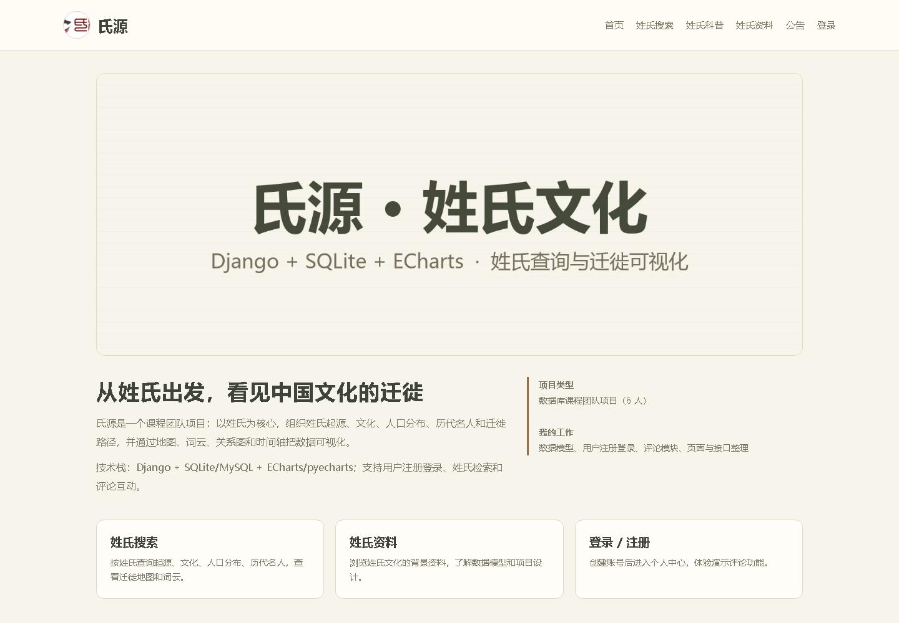
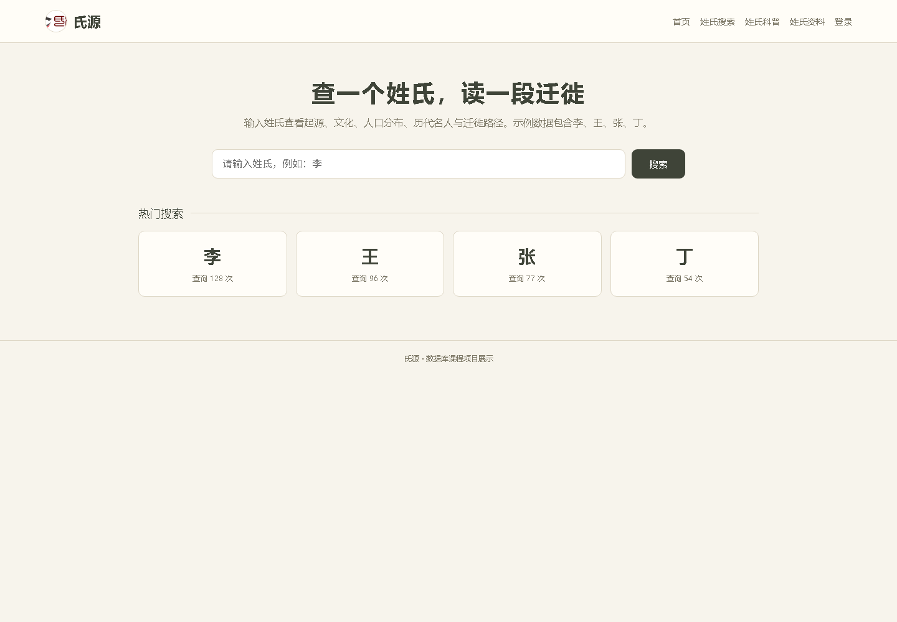
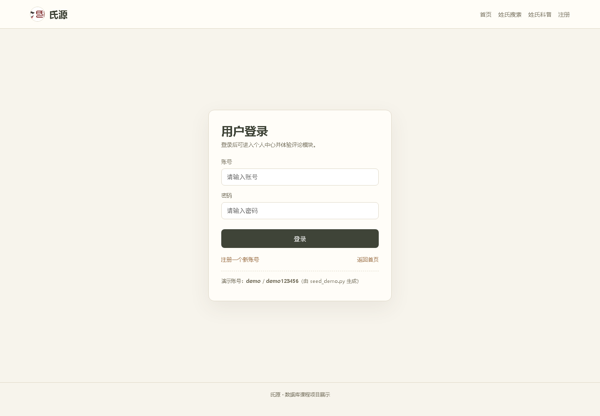
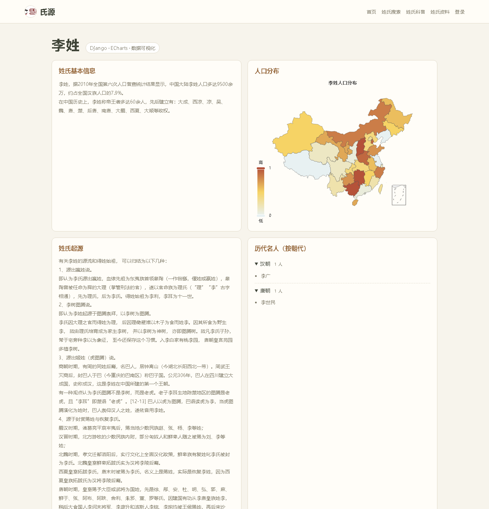
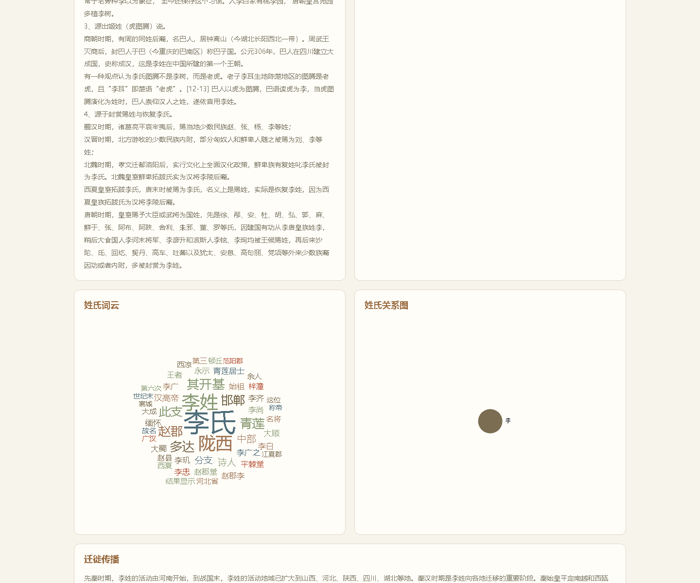
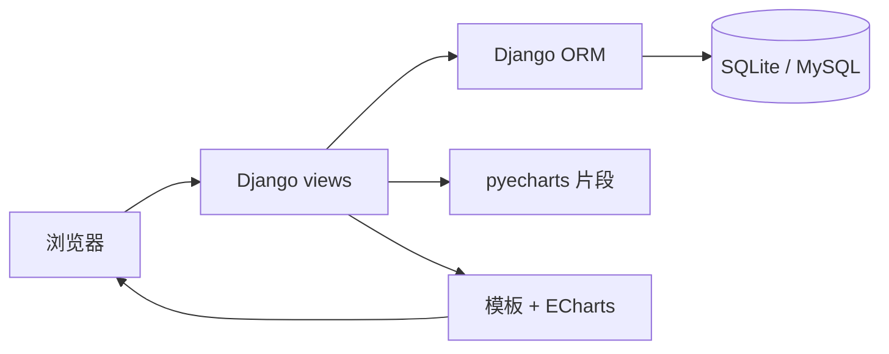

# 氏源 · 姓氏文化查询与可视化

> Django + SQLite/MySQL + ECharts 的姓氏文化网站：搜索一个姓氏，查看它的起源、文化、人口分布、历代名人和迁徙路径。  
> 数据库课程团队项目的**可运行整理版**。



## 30 秒了解

- **做什么**：把姓氏文本资料组织成数据库，并用地图、词云、关系图和迁徙时间轴可视化。
- **技术栈**：Django 5.2、SQLite（可换 MySQL）、ECharts、pyecharts、Django 模板 + 原生 JS。
- **我的工作**：姓氏数据模型、用户注册登录、评论模块、页面/路由整理、演示数据、README 与安全清理。
- **不是**：不是完整论坛，也不是生产系统；没有后台审核、弹幕流和部署配置。课程报告里的评论/弹幕设想，当前实现为评论 CRUD。

## 效果截图

| 姓氏搜索 | 登录 |
|---|---|
|  |  |

姓氏详情（人口分布地图、起源文本、按朝代的名人列表）：



词云与关系图：



## 项目背景

氏源是上海财经大学《数据库原理》课程（2021 Fall）的六人小组项目。原始项目以 MySQL 为数据库，包含姓氏资料、地图、词云、名人、关系图和迁徙路径等功能。课程结束后，本仓库做了这些整理：

- 从原始工程中找回完整的 Django 后端、模板、静态资源和词云 pickle；
- 用 SQLite 提供无需安装 MySQL 的演示路径；
- 增加李、王、张、丁四个姓氏的示例数据和可重复执行的 seed 脚本；
- 移除硬编码 `SECRET_KEY`、真实数据库密码、明文密码比较和外部图片/CDN 依赖；
- 修复若干运行时 bug，补充 README、API 摘要和截图。

## 功能

- 用户注册、登录、退出、个人中心；
- 姓氏搜索、热门搜索；
- 姓氏详情：基本信息、起源、文化、人口分布；
- 人口分布地图（ECharts map）；
- 历代名人按朝代展示；
- 姓氏词云（ECharts wordCloud）；
- 姓氏关系图（ECharts graph）；
- 迁徙路径（pyecharts Timeline/Map）；
- 评论增删改查（课程原型，接口使用 GET）。

## 技术栈与架构

- **后端**：Django 5.2，Django ORM，SQLite（默认）/ MySQL（可选）；
- **可视化**：ECharts + pyecharts；
- **前端**：Django 模板 + 原生 JS/CSS（不再依赖 QQ/百度外链图片）；
- **数据**：四个示例姓氏的原始文本 + seed 脚本生成的省份、朝代、分布、名人、评论数据。



## 数据模型

| 表 | 说明 |
|---|---|
| `surname` | 姓氏主数据：基本信息、起源、文化、迁徙、人口分布文本 |
| `province` | 省份维度 |
| `dynasty` | 朝代及起止时间 |
| `distribution` | 姓氏 × 省份人口比例 |
| `famous` | 姓氏 × 朝代名人 |
| `user` | 自定义用户（密码使用 Django hash） |
| `comment` | 用户评论 |

更完整的课程报告摘要见 [`docs/PROJECT_REPORT.md`](docs/PROJECT_REPORT.md)，路由/接口见 [`docs/API.md`](docs/API.md)。

## 快速开始

要求：Python 3.10+（推荐 3.12/3.13）。

```bash
python -m venv .venv
source .venv/Scripts/activate        # Git Bash on Windows
pip install -r requirements.txt

# 本地开发需要 DEBUG=1，静态文件才会由 runserver 提供
export DJANGO_SECRET_KEY=dev-only-change-me
export DJANGO_DEBUG=1
export DJANGO_ALLOWED_HOSTS=127.0.0.1,localhost

python manage.py migrate
python scripts/seed_demo.py
python manage.py runserver 127.0.0.1:8000
```

打开 <http://127.0.0.1:8000/>。

**演示账号**：`demo` / `demo123456`（由 `scripts/seed_demo.py` 创建）。

> 在 PowerShell 中请用 `$env:DJANGO_DEBUG="1"` 等写法；`.env.example` 是配置示例，项目本身不自动加载 `.env`。

## 项目结构

```text
shiyuan/
├─ manage.py
├─ project/                 # Django settings / urls
├─ Surname/                 # 姓氏、省份、朝代、分布、名人
│  ├─ models.py
│  ├─ views.py              # 详情页、图表数据、迁徙解析
│  ├─ templates/surname/    # 首页/搜索/详情/资料/科普/公告/团队
│  └─ static/Surname/       # ECharts、词云扩展、词云 pickle
├─ user/                    # 注册登录、个人中心、评论
│  ├─ models.py
│  ├─ views.py
│  └─ templates/user/
├─ scripts/
│  ├─ import_surnames.py    # 导入 data/surnames 下的文本
│  └─ seed_demo.py          # 生成可运行演示数据
├─ data/surnames/           # 李、王、张、丁四个示例姓氏
├─ docs/
│  ├─ PROJECT_REPORT.md
│  ├─ API.md
│  └─ images/
├─ requirements.txt
└─ .env.example
```

## 数据与脚本

完整课程数据包含 300+ 姓氏，体积较大且含原始课程素材，**没有提交**。仓库只保留四个示例：

```bash
# 重新导入四个示例姓氏的文本
python scripts/import_surnames.py

# 生成省份、朝代、分布、名人、演示账号和评论
python scripts/seed_demo.py
```

如果把同结构的姓氏目录放进 `data/surnames/`，两个脚本就会处理新增数据。

## 安全与限制

这是课程作业整理版，不是生产系统：

- 评论接口为了兼容原前端使用 GET 参数；生产环境应改为 POST + CSRF，并增加审核/权限；
- 没有完整的论坛、弹幕、后台审核和部署配置；
- 示例账号和评论只存在本地 SQLite，请不要使用真实密码；
- 原项目的 `SECRET_KEY`、数据库口令、`DEBUG=True`、`ALLOWED_HOSTS=['*']`、CORS `*` 已清理；
- 演示数据中的分布比例是为可视化生成的示例值，不代表真实统计。

## 使用说明

本项目为课程作品展示，**未添加开源 LICENSE**；未经许可请勿商用。请不要把仓库里的示例账号/数据用于真实业务。
