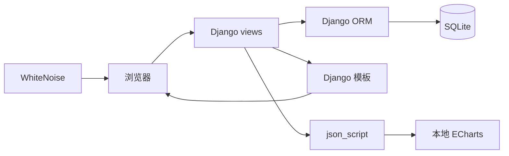

# 氏源项目技术报告

## 1. 背景与目标

氏源源自上海财经大学《数据库原理》（2021 Fall）六人小组项目，主题是用数据库组织姓氏的源流、人物、迁徙与分布，并通过可视化辅助阅读。2026 年的重构目标是把它从课程原型变成一个**可运行、可测试、可公开展示**的 Django 项目：

- 先修复安全问题与数据丢失，再扩展内容与视觉；
- 所有资料文本完整保存，默认转义；
- 数据从唯一的 JSON 文件可复现加载；
- 关键路径有自动化测试与查询预算；
- 不依赖外部 CDN，移动端、夜间模式、无障碍与 SEO 达到可发布水平。

## 2. 功能范围

| 模块 | 能力 |
|---|---|
| 首页 | 搜索、拼音首字母索引、精选姓氏、每日一姓、统计 |
| 目录与搜索 | 关键词/首字母/省份/排序筛选、分页、空状态、查询参数保留 |
| 姓氏详情 | TOC、源流、迁徙、分布、人物、文化、来源、评论、收藏、打印/复制 |
| 可视化 | 分布地图、迁徙时间轴、关系图、词云；懒加载 + 文本替代表 |
| 人物 | 按朝代/姓氏筛选，人物详情与同朝代人物 |
| 源流 | 宗族节点与“源出/分支/改姓/同源”关系图 + 表格 |
| 账号 | 注册/登录/退出、资料与密码修改 |
| 个人数据 | 收藏、浏览历史（保留最近 50 条）、本人评论管理 |
| API | `/api/v1/` 只读姓氏、详情、搜索、人物、元数据 |
| 发布 | sitemap、robots、canonical、OG/Twitter、JSON-LD、404/500 |

不在范围内：支付/真实会员、完整论坛、SPA、离线 App、权威人口统计。

## 3. 架构

- Django 5.2 + 服务端模板 + 原生 JS；无 Node 构建链。
- `Surname` 负责目录与知识网络，`user` 负责账号、评论、收藏与历史。
- 静态资源（ECharts、中国地图、词云插件）放在 `static/vendor/`，开发由 runserver 提供，生产由 WhiteNoise 提供。
- 图表数据通过 `json_script` 从视图传入，模板不拼接 JS 字符串；图表容器提供 `role="img"` 与数据表。

## 4. 数据模型

核心表：

| 表 | 说明 | 关键约束 |
|---|---|---|
| `surname` | 姓氏主数据、长文本、关键词 JSON、演示标记 | `slug` 唯一；首字母 A–Z |
| `province` | 省份、地图名、中心经纬度 | `name` 主键、`slug` 唯一 |
| `dynasty` | 朝代与排序 | `name` 主键、`slug` 唯一 |
| `distribution` | 姓氏 × 省份 | `(surname, province)` 唯一；强度 0–100 |
| `famous` | 人物 × 姓氏 × 朝代 | 人物 `slug` 唯一；同姓同朝同名唯一 |
| `clan` | 宗族节点 | `name`/`slug` 唯一 |
| `surname_relation` | 姓氏→姓氏/宗族关系 | 目标 XOR；重复边校验 |
| `migration_event` | 迁徙事件 | 按朝代与顺序排序 |
| `profile` | 内置 User 的扩展资料 | 一对一 |
| `comment` | 评论 | 用户/姓氏外键、状态、索引 |
| `favorite` / `reading_history` | 收藏 / 历史 | 用户+姓氏唯一 |

设计要点：

- 用 `ForeignKey` 替代原 M2M 表达“姓氏-省份”“人物-朝代”，消除重复与交集查询；
- 唯一约束与检查约束把数据完整性放到数据库层；
- 长文本统一 `TextField`，不再截断；
- 内置 `auth.User` + `Profile`，避免自定义用户缺失权限体系与迁移风险；
- `is_demo`、`is_imported`、`source_note`、`is_illustrative` 显式标注演示数据与未校订的课程原始资料。

## 5. 数据管线

1. `data/surnames/` 保留李、王、张、丁原始课程文本；本机课程归档提供 346 个姓氏文件夹；
2. `Surname/services/source_archive.py` 以纯函数解析归档：读取六个文本文件、映射 50 种朝代标题、清洗纯文本、按 `(姓氏, 姓名)` 合并人物；
3. `scripts/generate_catalog.py` 生成 33 个整理条目，并把 315 个导入条目合并进 `data/catalog.json`（31 个重叠姓氏保留整理正文，只追加原始人物）；
4. `validate_catalog` 检查数量、slug/拼音/首字母唯一、强度范围、引用存在、来源说明、`is_imported` 契约与纯文本策略；
5. `load_catalog` 在事务中按自然键 `update_or_create`，可重复运行；`--dry-run` 不写库；
6. `seed_demo` 创建 34 个省份、22 个时期、演示账号、评论、收藏与历史，可重复运行。

最终数据规模：348 个姓氏、6,251 位人物、66 条迁徙事件、36 条源流关系。加载失败不会留下半套数据（`transaction.atomic`）。

## 6. 安全设计

- **认证**：Django 内置 User、密码哈希、登录 session 轮换；登录失败统一提示，不泄露账号是否存在。
- **CSRF**：所有写操作 POST + CSRF；退出、收藏、评论、历史删除均不暴露 GET 写接口。
- **对象所有权**：收藏/历史/评论删除按 `request.user` 过滤；staff 隐藏评论仍需 POST。
- **输出转义**：模板默认转义；资料与评论不使用 `|safe`；JSON-LD 自定义过滤器转义 `<`、`>`、`&`、U+2028/2029。
- **密钥与配置**：生产缺少 `DJANGO_SECRET_KEY` 直接报错；密钥、数据库、`.dev-secret-key` 均 gitignore。
- **限流与审计**：登录 5 次/5 分钟（IP+账号），评论 10 条/10 分钟（用户）；记录登录失败/成功、评论删除/隐藏，不记录密码。
- **安全头**：SameSite Lax、`nosniff`、`X-Frame-Options: DENY`、Referrer-Policy；HTTPS 环境开启 HSTS/Secure Cookie。
- **反向代理**：仅当 `DJANGO_TRUST_X_FORWARDED_PROTO=1` 时信任 `X-Forwarded-Proto`，使 TLS 终止代理后的跳转、canonical 与 sitemap 使用 https；直连部署保持关闭，避免伪造。
- **部署检查**：测试在生产环境变量下运行 `check --deploy`，要求零问题。

## 7. 性能

- 列表分页；详情用 `Prefetch`/`select_related` 预取分布、人物、迁徙、关系与评论；
- 查询预算由测试固定：首页 6、目录 ≤5、详情 ≤16、人物列表 ≤5、人物详情 ≤4；
- 浏览计数只做一次 `F("view_count") + 1`；
- ECharts 仅在详情/源流页加载，`IntersectionObserver` 懒初始化，窗口缩放防抖；
- 生产静态资源使用压缩 manifest 与一年缓存；
- 未启用整页缓存：页头包含登录态与 CSRF 表单，避免跨用户串页；当前规模下查询预算足够。

## 8. 测试与验收

- 222 个 Django 测试：模型约束、catalog 加载/校验、课程归档解析与 348/6,251 数据契约、搜索分页、详情预算、图表 payload、认证/CSRF/IDOR、XSS、收藏/历史、API envelope、SEO、部署检查、反向代理与审计日志配置；
- `ruff check .` 静态检查；
- Lighthouse Accessibility 5 页 1.00；375/768/1440 px 无横向溢出；图表在夜间模式正确重绘；
- GitHub Actions 跑 `check`、`test`、`ruff` 与生产 `collectstatic`；
- 详见 [`QA.md`](QA.md)。

## 9. 已知限制

- SQLite 适合当前 348 姓氏/6,251 人物/单 worker；多实例、持续高并发写或全文检索时需切换 PostgreSQL；
- 33 个整理条目为课程演示整理，315 个导入条目为未校订课程资料；分布强度不是统计值；
- 原始资料缺章节普遍存在，未自动抽取结构化分布/迁徙/关系；人物仅按姓名合并，未做实体消歧；
- 评论无分页；搜索为 `icontains`，未上全文索引；
- API 只读且未加认证/限流；
- 未实现邮箱验证与找回密码；
- 部署文档给出 gunicorn + WhiteNoise 路径，未附带 Docker/云平台配置。

## 10. 团队与许可

原课程项目：上海财经大学《数据库原理》2021 Fall 六人小组（熊博雅、张军、安津毅、袁月、谭峰、向怡然）。本仓库由安津毅整理重构。

课程作品展示用途，未添加开源 LICENSE；未经许可请勿商用。参考产品仅借鉴信息架构，未复制文本、图片、数据或品牌。
