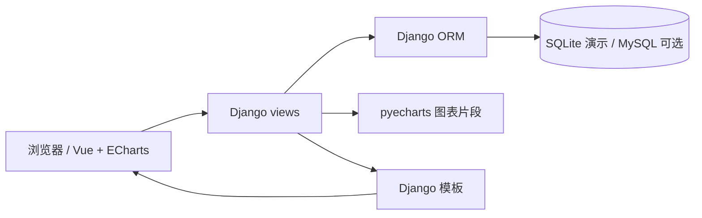

# 氏源项目说明

## 背景

氏源是上海财经大学《数据库原理》课程（2021 Fall）的六人小组项目。项目以姓氏文化为主题，把姓氏的起源、文化、人口分布、历史名人和迁徙文本组织成可查询、可比较、可追踪的数据，并通过 Web 页面和图表展示。

课程结束后，安津毅在 2026 年把项目整理成一个可运行的展示仓库：

- 找回并整理完整的 Django 后端、模板和静态资源；
- 用 SQLite 提供无需安装 MySQL 的演示路径；
- 增加四个姓氏的示例数据和可重复执行的 seed 脚本；
- 移除硬编码密钥、明文密码比较、外部图片依赖和无关文件；
- 补充 README、API 摘要和截图。

## 功能

1. 用户注册、登录、退出、个人中心；
2. 姓氏搜索与热门搜索；
3. 姓氏详情：基本信息、起源、文化、人口分布；
4. 人口分布地图（ECharts map）；
5. 历代名人按朝代组织（详情页折叠列表）；
6. 姓氏词云（ECharts wordCloud）；
7. 姓氏关系图（ECharts graph）；
8. 迁徙路径（pyecharts Timeline/Map）；
9. 评论增删改查（课程原型）。

课程报告里提到的“评论/弹幕 + 后台审核”是原始设想；当前仓库实现的是评论 CRUD，没有完整的论坛、后台审核和弹幕流。README 和简历都不应把它写成“论坛”。

## 数据模型

| 表 | 字段/关系 | 说明 |
|---|---|---|
| `surname` | `second_name` PK，基本信息/名人/迁徙/分布/起源/文化文本，`father_surname` 自关联 | 姓氏主数据 |
| `province` | `name` PK | 省份维度 |
| `dynasty` | `name` PK，`begin`/`end` | 朝代与起止时间 |
| `distribution` | 姓氏 M2M、省份 M2M、`ratio` | 姓氏 × 省份人口比例 |
| `famous` | 姓氏 M2M、朝代 M2M、姓名、简介 | 姓氏 × 朝代名人 |
| `user` | 账号 PK、用户名、姓氏、VIP 信息、密码 hash | 自定义用户 |
| `comment` | 用户 FK、内容、创建时间 | 评论 |

规范化说明（摘要）：

- 1NF：把名人的朝代、分布等重复属性拆到关系表；
- 2NF：关系表的主键由姓氏/省份/朝代等组合键构成，非主属性完全依赖主键；
- 3NF：`surname`、`dynasty`、`distribution`、`famous` 中非主属性不传递依赖主键；
- BCNF：课程报告说明未完全展开，当前实现按 3NF 组织。

## 架构

- 后端：Django 5.2（项目原为 Django 4.0，整理时升级）；
- 数据库：默认 SQLite，可改为 MySQL；
- 可视化：ECharts + pyecharts；
- 前端：Django 模板 + 少量原生 JS；原 Vue 组件保留在模板结构中但不再依赖外部 CDN。

## 复杂度与取舍

- 分布图需要遍历省份并取“姓氏 × 省份”的交叉数据；示例数据只有四个姓氏，行数很小。
- 词云由 `Surname/static/Surname/model/word` 的 pickle 提供（346 个姓氏的权重），整理时保留，缺失时页面降级为空词云。
- 名人树从 `famous` 关系表按朝代聚合，避免在姓氏主表里存重复的名人列表。
- 迁徙文本用关键词识别朝代和省份，生成时间轴地图；这是课程项目的简化 NLP，不做实体识别。

## 团队与我的工作

课程报告中的小组成员：熊博雅、张军、安津毅、袁月、谭峰、向怡然。仓库不包含学号和评分材料。

安津毅在整理版中负责：

- 姓氏数据模型、数据导入脚本与演示数据；
- 用户注册登录、个人中心、评论模块；
- Django 模板、路由、接口整理；
- 截图、README、安全清理与可运行性验证。

原始项目是团队课程作业；本仓库不代表任何公司或商业产品。
